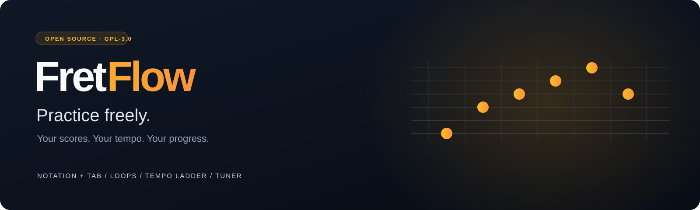
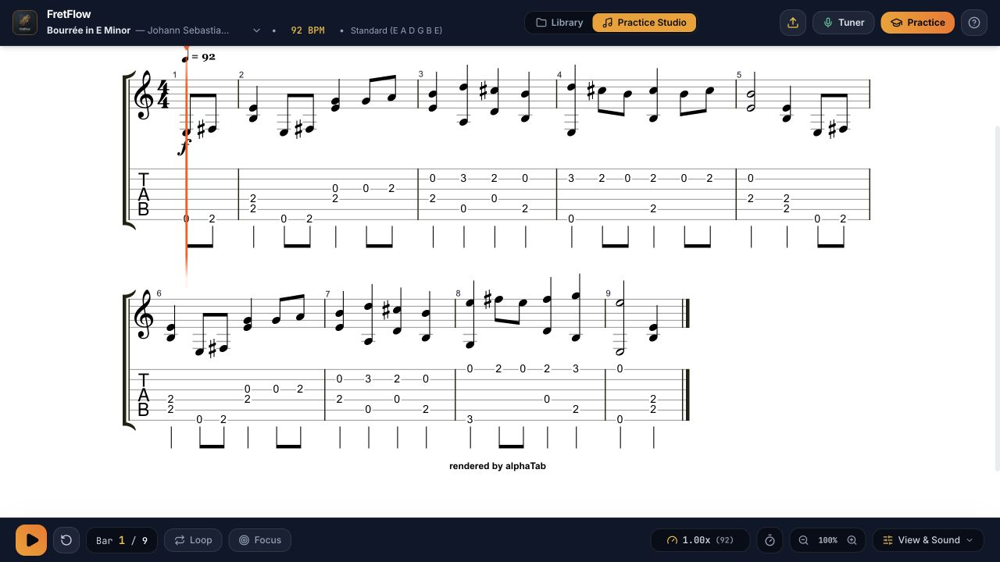

<div align="center">



**An open-source guitar practice workspace.**

Slow down a difficult passage, loop it, and build it back up—without a subscription tier separating you from the practice tools.

[](LICENSE)
[](docs/KNOWN_ISSUES.md)
[](https://github.com/Latexmanwebb/fretflow/actions/workflows/build.yml)
[](https://latexmanwebb.github.io/fretflow/)

[Try the live demo](https://latexmanwebb.github.io/fretflow/) · [Get started](#get-started) · [What you can do](#what-you-can-do) · [Roadmap](docs/ROADMAP.md) · [Contribute](CONTRIBUTING.md) · [Report a bug](https://github.com/Latexmanwebb/fretflow/issues/new/choose)

</div>

## Why FretFlow?

Learning an instrument takes enough patience already. FretFlow brings score playback, focused repetition, and guitar visualizers into one workspace that anyone can study, improve, and share.

There is no FretFlow account, subscription, or paid feature tier. Use scores you created or have permission to use. FretFlow does not retrieve songs from Soundslice, Songsterr, or other paid libraries, and is not affiliated with those services.

> **Early alpha:** the browser interface and production build are checked, but the application still has [known limitations](docs/KNOWN_ISSUES.md). The supplied macOS 1.0.0 build failed signature verification and is **not offered here as a verified download**. This repository is the source preview; a tested macOS release is a priority.

## What you can do

| Tool | Practice use |
| --- | --- |
| **Notation + tablature** | Read standard notation, tab, or both with a moving playback cursor. |
| **Tempo controls** | Slow a passage down and increase speed as you become comfortable. |
| **Loops + focus mode** | Isolate a bar or range instead of restarting the whole piece. |
| **Practice mode** | Work through short chunks with a configurable tempo ladder and repetition counter. |
| **Guitar visualizer** | Follow fret/string positions and explore scale overlays. |
| **Chromatic tuner** | Use your microphone for local pitch detection. Microphone permission is optional. |
| **Your library** | Import supported scores and revisit bundled practice examples, including 120 Giuliani exercises. |

Repetition counting follows playback loops; it does **not** grade your playing. The latest interface does not include an AI tutor.

<details>
<summary><strong>See the current interface</strong></summary>



Screenshot of the current browser interface. The desktop distribution has separate verification requirements; this screenshot is not evidence that the supplied macOS app runs correctly.

</details>

## Get started

### Run locally

Install **Node.js 22 LTS** and npm, then:

```bash
git clone https://github.com/Latexmanwebb/fretflow.git
cd fretflow
npm ci --ignore-scripts
npm run dev
```

Open the local URL printed by Vite, normally `http://localhost:5173`. Lifecycle scripts are disabled for the browser-only setup; Electron needs its official runtime download before desktop development.

The repository bundles notation fonts and a SoundFont for playback. Once dependencies are installed and the local server is running, the core practice interface uses local assets. Initial dependency installation requires internet access. It does not fetch songs for you.

### Build the web app

```bash
npm run build
npm run preview
```

The build checks TypeScript and creates `dist/`. Passing it verifies compilation and bundling, not microphone accuracy, audio quality, or desktop installation.

### macOS development

The current packaging target is **Apple Silicon (arm64)**. Intel Mac support has not been validated.

If you installed with lifecycle scripts disabled, download Electron's runtime from the installed official package before using desktop commands:

```bash
node node_modules/electron/install.js
npm run build
npm run desktop
```

For development with Vite, keep `npm run dev` running in one terminal and run `npm run desktop:dev` in another. The desktop development command expects Vite on port 5173.

The existing `desktop:dist` script produces a macOS app directory. Public distribution still requires a reproducible build, correct signing, appropriate microphone configuration, and a clean-machine test. See [release readiness](docs/RELEASE_READINESS.md).

## Scores and exports

- **Import:** Guitar Pro (`.gp`, `.gp3`, `.gp4`, `.gp5`, `.gpx`), MusicXML (`.musicxml`, `.xml`), and basic ASCII tab (`.txt`, `.tab`). Format support varies with score content.
- **MuseScore:** export your score as MusicXML first. Native MuseScore import is not reliable.
- **MIDI import:** not supported; some old UI labels and the native file dialog still list it.
- **Export:** print/PDF, Guitar Pro, MIDI, and AlphaTex. MP3 and MusicXML export are not implemented.

**Keep your original score files.** The current local library uses browser storage, can silently fail when full, and retains at most 30 uploaded entries. It is not a backup system. Browser and desktop profiles have separate storage.

## Keyboard shortcuts

| Shortcut | Action |
| --- | --- |
| `Space` | Play / pause |
| `L` | Toggle looping |
| `O` | Toggle focus mode |
| `F` | Toggle fretboard |
| `M` | Toggle metronome |
| `Esc` | Close active panels / leave focus mode |
| `Cmd/Ctrl` + `+` / `-` | Adjust score zoom |

## Help shape it

Bug reports, readable documentation, accessibility improvements, and real-world practice feedback are welcome. Start with the [roadmap](docs/ROADMAP.md) or [contribution guide](CONTRIBUTING.md). For audio or score issues, include a small score you have permission to share, the app/source version, and your OS/browser.

## License and credits

FretFlow's first-party code and project documentation are licensed under **[GPL-3.0-only](LICENSE)**. This permits commercial use as well; distributed modified versions must follow the license's source-sharing requirements. Third-party libraries, fonts, and audio assets keep their own licenses.

Built with [alphaTab](https://alphatab.net/), React, TypeScript, Vite, Tailwind CSS, and Electron. Music notation uses Bravura; interface text uses Inter and JetBrains Mono. See [third-party notices](THIRD_PARTY_NOTICES.md) and [asset provenance](docs/ASSET_PROVENANCE.md).
